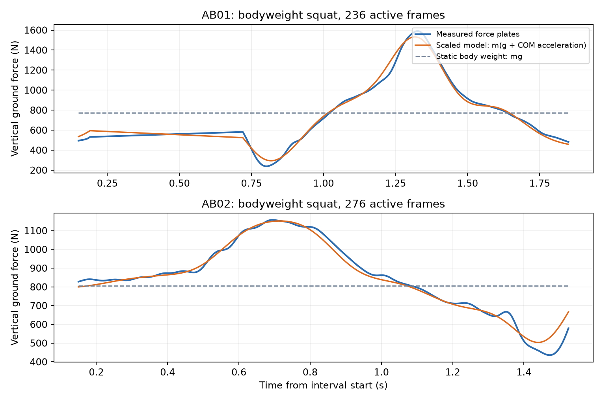
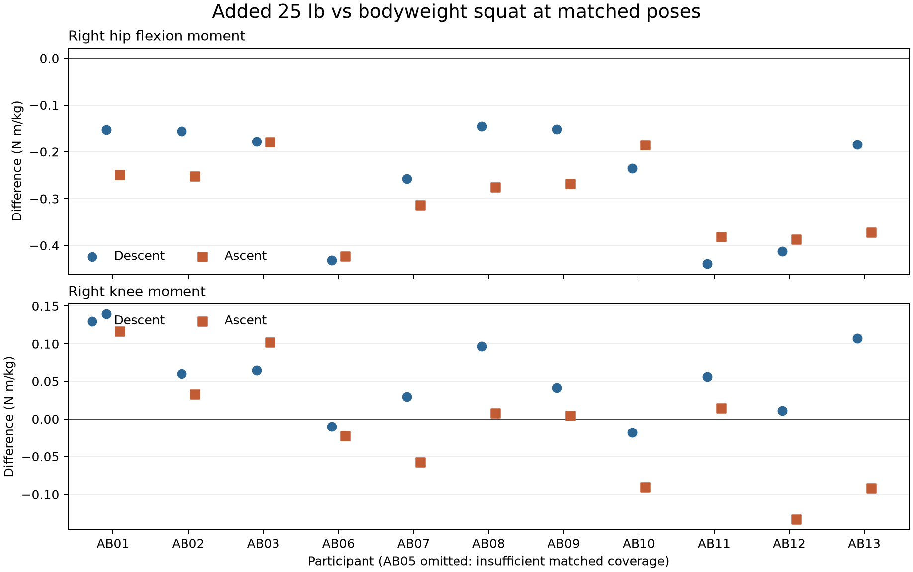

# 动态深蹲的外部动力学对照

更新：2026-09-25。这里把项目的深蹲物理模型与独立实验数据接轨。已完成自重及额外 25 lb 条件下的手机预设**整体竖直支撑力**与力板误差对照，以及实验净关节力矩和肌电的研究核查；**尚未验证个人关节净力矩或单块肌肉力量**。对照使用了实验动作分段，不能当作仅凭用户填写参数即可达到的个人预测精度。

新增[少量手填参数的整人留出关节力矩检验](深蹲少量输入关节力矩检验.md)：12 人的 39 次自重与 36 次额外 25 lb 深蹲中，即使用实验真值代选手机的三档深度和节奏，右髋、右膝误差的逐人改善区间仍跨零。手机界面只把它作为实验对照，不据此显示个人发力。

## 数据来源

[Scherpereel 等，*Scientific Data* 10:924 (2023)](https://www.nature.com/articles/s41597-023-02840-6)公布了 12 人进行动态深蹲等动作时的运动捕捉、力板与肌电数据。[Georgia Tech 原始存档](https://repository.gatech.edu/entities/publication/20860ffb-71fd-4049-a033-cd0ff308339e)按 CC BY 4.0 开放。此处选用每人的自重深蹲与额外 25 lb（约 11.34 kg）深蹲。AB05 的自重试次标为 `squats_2_0lbs`，其余标为 `squats_1_0lbs`。论文只称其为“带 25 lb 重量的深蹲”，没有交代重量置于背部、胸前还是手中；所提取的 CSV 也没有握持点或负重轨迹。因此**不能自动等同于杠铃背蹲**，也不能用本数据直接校准 App 中的杠铃作用线。

`scripts/inspect_second_skin.py` 通过 HTTP 范围请求从官方约 13 GB 的 `ProcessedData.zip` 提取选定 CSV，存入被 Git 忽略的 `.cache/lower-limb/`，不放进手机离线包。每个试次用到 `angle`、`moment_filt`、`grf`、`activity_flag` 四种 200 Hz CSV。关节角来自 OpenSim 逆运动学；`moment_filt` 是 OpenSim 逆动力学得到的**净关节力矩**，不是直接测得的单块肌肉力。地面反力 `grf` 来自力板。肌电文件为 2000 Hz 的原始未滤波信号，处理方法见下文。复现提取（已存在的文件按 ZIP CRC 校验后跳过）：

```powershell
& '.cache/opensim-venv/Scripts/python.exe' scripts/inspect_second_skin.py --archive lower-limb --dynamic-squats --include-emg --list-limit 0
& '.cache/opensim-venv/Scripts/python.exe' scripts/inspect_second_skin.py --archive lower-limb-raw --dynamic-squats --list-limit 0
```

**力矩单位复核：有强证据按 N·m/kg 读取。**随档 README 将 `moment_filt` 写作 N·m，但论文图示和官方 `Code.zip/Plot_3x3_plots.m` 的坐标轴均写 N·m/kg。我们从原始标记点、受试者缩放 OpenSim 模型与力板外力独立重算 AB01、AB02 各自的自重和 25 lb 片段；原先加入力板自由力矩时 12 个右髋／膝／踝、受试者、负重组合中有 11 个更支持 CSV×体重。进一步只去掉自由力矩后，**12/12 个组合**均在乘体重后与重算 N·m 更一致，且 AB01 六个组合的平均绝对差按两位小数显示为 0.00 N·m。档案 README 的单位冲突仍记录在案；源作者设置文件未提供，不能把这项受控复算当作所有人的完整处理流程验证。

### 从原始标记与力板复算单位

可从原始档案提取 AB01、AB02 的 `MarkerData/squats_1.trc`、`ExtLoads/squats_1.mot` 和原始角度／力矩 CSV（两人的缩放模型与体重表已由前面的动态数据提取命令取得）。以下是 AB01 的按需提取与自重、25 lb 重放；AB02 将 `--member` 路径及 `--subject` 改为 `AB02`，自重时间窗改为 `--start 23 --end 25`，25 lb 时间窗仍为 `--start 1 --end 3`。输出原始片段保留在 `.cache/`：

```powershell
& '.cache/opensim-venv/Scripts/python.exe' scripts/inspect_second_skin.py --archive lower-limb-raw --member AB01/MarkerData/squats_1.trc --member AB01/ExtLoads/squats_1.mot --member AB01/CSV_Data/squats_1/Joint_Angle.csv --member AB01/CSV_Data/squats_1/Joint_Moments.csv --list-limit 0
& '.cache/opensim-venv/Scripts/python.exe' scripts/reproduce_dynamic_squat_ik.py --start 50 --end 52
& '.cache/opensim-venv/Scripts/python.exe' scripts/reproduce_dynamic_squat_id.py --start 50 --end 52
& '.cache/opensim-venv/Scripts/python.exe' scripts/analyze_dynamic_squat_id_replay.py --start 50 --end 52 --condition 0lbs --output docs/data/dynamic_squat_id_replay_ab01_0lbs.json
& '.cache/opensim-venv/Scripts/python.exe' scripts/reproduce_dynamic_squat_ik.py --start 1 --end 3
& '.cache/opensim-venv/Scripts/python.exe' scripts/reproduce_dynamic_squat_id.py --start 1 --end 3
& '.cache/opensim-venv/Scripts/python.exe' scripts/analyze_dynamic_squat_id_replay.py --start 1 --end 3 --condition 25lbs --output docs/data/dynamic_squat_id_replay_ab01_25lbs.json
```

逆运动学对同源公开角度的六个髋／膝／踝坐标平均绝对差均低于 0.01°。逆动力学使用双侧力板力与作用点、6 Hz 坐标低通，**显式排除模型肌肉力**；否则模型被动肌力会把髋／膝结果推到千 N·m 级。为减少短片段滤波边界影响，下面只比较两秒片段中间的 1.2 秒。表中误差单位均为 N·m：

| 受试者／片段 | 关节 | CSV 当作 N·m，含自由力矩 MAE | CSV×体重，含自由力矩 MAE | CSV×体重，去掉自由力矩 MAE |
| --- | --- | ---: | ---: | ---: |
| AB01 自重 | 右髋 | 35.28 | 12.92 | 0.00 |
| AB01 自重 | 右膝 | 80.97 | 7.61 | 0.00 |
| AB01 自重 | 右踝 | 26.83 | 5.53 | 0.00 |
| AB01 25 lb | 右髋 | 47.90 | 19.34 | 0.00 |
| AB01 25 lb | 右膝 | 122.49 | 13.89 | 0.00 |
| AB01 25 lb | 右踝 | 29.74 | 12.17 | 0.00 |
| AB02 自重 | 右髋 | 60.73 | 7.82 | 2.21 |
| AB02 自重 | 右膝 | 29.85 | 23.24 | 2.06 |
| AB02 自重 | 右踝 | 45.37 | 23.13 | 0.90 |
| AB02 25 lb | 右髋 | 97.12 | 16.20 | 3.40 |
| AB02 25 lb | 右膝 | 31.34 | 32.73 | 2.60 |
| AB02 25 lb | 右踝 | 62.38 | 31.49 | 1.26 |

含自由力矩的逐坐标数据在 [AB01 自重](data/dynamic_squat_id_replay_ab01_0lbs.json)、[AB01 负重](data/dynamic_squat_id_replay_ab01_25lbs.json)、[AB02 自重](data/dynamic_squat_id_replay_ab02_0lbs.json)和[AB02 负重](data/dynamic_squat_id_replay_ab02_25lbs.json)；去掉自由力矩的数据在 [AB01 自重](data/dynamic_squat_id_replay_ab01_0lbs_no_free_moment.json)、[AB01 负重](data/dynamic_squat_id_replay_ab01_25lbs_no_free_moment.json)、[AB02 自重](data/dynamic_squat_id_replay_ab02_0lbs_no_free_moment.json)和[AB02 负重](data/dynamic_squat_id_replay_ab02_25lbs_no_free_moment.json)。原先 AB02 负重右膝似乎不支持 N·m/kg，是包含自由力矩的计算链造成的例外。`RawData.zip/Joint_Moments.csv` 与 `ProcessedData.zip/moment_filt` 数值接近但不完全一致；后者经过额外滤波。上述改进验证的是公开 CSV 的关节净力矩量纲与一个外力处理约定，不是 App 的个人关节或肌肉力预测精度。

后来对 AB01、AB02 的自重深蹲又做了只改变一项输入的受控对照：**不向 OpenSim 外力对象加入原始力板自由力矩向量**，其余姿态、力、压力中心和滤波均保持不变。对两秒片段中间 241 帧，AB01 六个左右髋部净力矩坐标与原始 CSV×体重的平均绝对差都降至 ≤0.01 N·m；AB02 为 0.36–2.21 N·m。最深片段的细节见[自由力矩对照](data/deep_squat_hip_id_alignment.json)和[OpenSim 研究记录](OpenSim研究记录.md)。这强烈支持源 CSV 的 ID 约定没有使用力板自由力矩，且支持按 N·m/kg 解读；作者的实际设置文件未提供，仍不能宣称完整复现了原处理流程。关节净力矩一致也不能验证单肌肉力量。

已有上述 IK 与原始力板文件时，对 AB01 自重的受控复算命令如下；AB01 负重改为 1–3 秒和 `25lbs`，AB02 自重改为 23–25 秒，输出文件名按受试者和条件调整：

```powershell
& .cache/opensim-venv/Scripts/python.exe scripts/reproduce_dynamic_squat_id.py --subject AB01 --start 50 --end 52 --omit-free-moment
& .cache/opensim-venv/Scripts/python.exe scripts/analyze_dynamic_squat_id_replay.py --subject AB01 --start 50 --end 52 --condition 0lbs --omit-free-moment --output docs/data/dynamic_squat_id_replay_ab01_0lbs_no_free_moment.json
& .cache/opensim-venv/Scripts/python.exe scripts/audit_deep_hip_id_alignment.py
```

### 动态质心与力板的物理一致性

`scripts/audit_dynamic_squat_gravity_balance.py` 另把 AB01、AB02 的自重试次两秒实验逆运动学逐帧送入各自公开缩放模型，得到全身质心的竖直加速度；再与两块力板的竖直力之和对比。101／205／305 ms 的三种局部三次平滑窗口只用于数值二阶导数，不等同作者的原始滤波。以下采用 205 ms 窗口，误差为有效动作帧的平均绝对误差：

| 受试者 | 有效帧 | 只取 `mg` 的力板误差 | `m(g + a_COM,y)` 的力板误差 | 后者 R² |
| --- | ---: | ---: | ---: | ---: |
| AB01 自重 | 236 | 284.0 N | 28.5 N | 0.989 |
| AB02 自重 | 276 | 155.2 N | 19.7 N | 0.975 |

改用 105／305 ms 窗口后，AB01 动态误差为 28.9／35.5 N，AB02 为 18.4／23.2 N，仍明显小于仅取 (mg)。205 ms 窗口下，横向两个坐标的力平衡平均绝对误差分别为 AB01 的 7.4／19.0 N、AB02 的 8.3／9.9 N。逐项结果见[动态重力平衡探针](data/dynamic_squat_gravity_balance.json)。实验 IK 来自标记点、地面反力来自独立力板，因此这检查了这两段公开数据和模型质量／运动学的牛顿第二定律一致性。它**没有验证手机端的预设姿态、动作速度、杠铃位置、关节净力矩或任何单块肌肉力**。结果也表明只用静态体重解释动态受力会遗漏重要加速度项。



复算本图及 JSON（需先取得上述 AB01、AB02 模型、两段 IK 与处理后的力板 CSV）：

```powershell
& '.cache/opensim-venv/Scripts/python.exe' scripts/audit_dynamic_squat_gravity_balance.py
```

### 手机预设深蹲对力板的独立检查

前述结果用的是**实验测得的运动学**。为了检查手机预设动作本身，`scripts/benchmark_template_squat_grf.py` 将 App 固定的 175 cm 深蹲姿态、2.8 秒播放时间和模板体段质心轨迹形成的 `m(g+a_COM)` 与公开的 **0 lb 自重**双力板记录比较。每次记录按右膝从一个近站立低点、经过一次下蹲峰值、回到下一个低点分段；筛查后为 12 人、39 次。每次动作的内部 99 个标准化时间点计算竖直力／受试者体重的平均绝对误差。静态体重常数 `1.0` 是事先设定的基线，模板没有用这些力板值拟合参数。

| 逐人中位数的跨人中位数 | 静态体重 | 手机默认 2.8 秒轨迹 | 用实验分段时长缩放轨迹 |
| --- | ---: | ---: | ---: |
| 竖直力／体重 MAE | 0.1143 | 0.1117 | 0.1050 |
| 优于静态基线的受试者 | — | 9/12 | 10/12 |

按人配对的误差改善中位数分别为体重的 **0.0087** 和 **0.0110**；以 12 人为重抽样单位的探索性 95% bootstrap 区间分别为 **0.0010–0.0193** 和 **0.0016–0.0311**。这是轻微改善，远不足以据此宣称手机个人动力学预测准确。记录中完整重复动作的时长逐人中位数为 2.652 秒，右膝最大屈曲角为 116.65°；当前手机默认姿态的右膝范围约 21.05–95.93°，在这批记录中明显偏浅。后一个“实测时长”方案还使用了实验分段信息，普通用户并未提供。两个方案都把实测动作起止点强行对齐到手机时间轴；不同受试者有静止停顿和不同的下蹲／起身节奏。数据只是处理后的力板与角度记录，实验身高未进入模板，且不含 App 的握杠位置。

将最低屈曲门槛由 50° 提至 70°、双侧活动标记覆盖率由 50% 提至 60% 的敏感性检查保留 10 人 30 次：固定时长模板的跨人 MAE 中位数为 0.1147，静态基线为 0.1268；9/10 人的模板误差较低。它只用于排查分段门槛的影响，结果保存在 Git 忽略的 `.cache/lower-limb/template_grf_strict.json`。

逐人、逐次结果和筛选门槛见[预设深蹲力板基准](data/squat_template_grf_benchmark.json)。复算需本地已提取的公开 `0lbs` 角度、活动标记、力板 CSV 和 `Subject_masses.csv`；先运行 `npm run build:blender-poses` 与 `npm run probe:squat-dynamic-grf`，再运行 `python scripts/benchmark_template_squat_grf.py`。这个结果只给**自重动作的整体垂直支撑力**设置下一道校准关口：应先调整或提供明确的深度与节奏设置，并在不借助实验分段对齐的留人数据上再检验。它没有验证杠铃深蹲的负重位置、髋／膝净力矩或单块肌肉力量，不能作为红色发力高亮的依据。

后续又用同一研究的 25 lb 条件检查了 App **现有负重支撑力公式**，见[额外 25 lb 深蹲模板对照](额外25磅深蹲模板对照.md)：12 人 36 次动作的固定示意轨迹误差逐人中位为总重量的 0.1085，恒定总重量基线为 0.1160，10／12 人改善；单独给额外重量加入运动加速度仅带来 0.0028 倍总重量的逐人配对改善中位数。论文没有说明重量的位置，也没有足以验证杠铃或单肌肉力量的数据。

已加入一个不需要拍摄视频的**动作幅度选择**：较浅约 75°、原型默认约 96°、较深约 117° 膝屈。后者由固定股骨／胫骨长度解出臀部最低高度，保持原有躯干前倾和骨盆前后位置假设；三种体型、101 个姿态点的长度和静态平衡筛查见[深度几何探针](data/squat_depth_probe.json)。它只调整预设模型，**不是根据使用者输入测得真实动作**。用同一批 12 人 39 次自重记录复算较深版后，固定 2.8 秒的力板 MAE 从默认版的 0.1117 **升至 0.1131**（静态基线 0.1143），改善人数从 9/12 降为 8/12；实测时长诊断的 MAE 从 0.1050 升至 0.1081。[较深版逐人基准](data/squat_template_grf_117_benchmark.json)与[动态支撑力探针](data/squat_dynamic_grf_117_probe.json)均标记为研究数据。膝角更接近这批实验的中位峰值，没有让整体力板预测更准确；不同人也有不同动作速度和停顿。界面因此保留旧版默认深度，三档仅供观察路径和外力矩情景，不提供个人肌肉力高亮。

### 动作时长敏感性（2026-09-25）

手机控制台现在可选 2.0／2.8／4.0 秒预设动作周期，不需拍视频。`src/mechanics.ts` 与 `scripts/probe_squat_dynamic_grf.mjs` 共用同一个竖直质心加速度计算；Blender 导出 JSON 可带 `--cycle-duration-s`，场景读取该值设定有效帧率。只改变时间尺度，不改变轨迹形状；相同阶段的加速度随时长平方的倒数变化。下表对同一批 12 人 39 次 **0 lb 自重深蹲**、相同默认深度和实验分段点作探索性比较：

| 预设周期 | 逐人 MAE 中位数的跨人中位数，以体重为单位 | 优于静态体重基线的人数 |
| --- | ---: | ---: |
| 2.0 秒 | 0.1149 | 7/12 |
| 2.8 秒 | 0.1117 | 9/12 |
| 4.0 秒 | 0.1109 | 10/12 |
| 静态体重 1.0 倍 | 0.1143 | — |

4.0 秒在此样本上略低，但三档是在同一批样本上事后检查，没有独立留出集可验证这种选择；误差差异不能解释为个人最佳速度。实验动作起止点由研究者标注，App 没有实际动作计时或轨迹。负重深蹲、不同深度和卧推／实力举的动态支撑力均未由此验证。中间探针和逐次诊断保存在 Git 忽略的 `.cache/lower-limb/template_grf_{2s,4s}*.json`；可用 `node scripts/probe_squat_dynamic_grf.mjs --duration-s 2 --out .cache/lower-limb/template_grf_2s.json` 及 `python scripts/benchmark_template_squat_grf.py --probe .cache/lower-limb/template_grf_2s.json --output .cache/lower-limb/template_grf_2s_benchmark.json` 重建，4 秒同理。界面继续把它称为**示意加速度情景**，不映射为单肌肉高亮。

再按**整名受试者留出**检查选择规则：每次只用其余 11 人的逐人 MAE 中位数，从 2.0／2.8／4.0 秒中选一档，然后评估留出者。12 次中选中 4.0 秒 11 次、2.0 秒 1 次；留出者误差的跨人中位数为 **0.1168 倍体重**，反而高于固定默认 2.8 秒的 **0.1117**，仅 3/12 人优于固定默认。逐人选择与误差见[节奏留人对照](data/squat_tempo_loso_benchmark.json)，可用 `python scripts/benchmark_squat_tempo_selection.py` 重算。这个检验仍发生在事后检查过三档的同一数据集，不是独立外部验证；但足以否决依据表面最小的 4 秒总体误差改动 App 默认节奏。手机仍保留 2.8 秒默认值，用户切换只改变教学情景。

### 只填幅度和节奏是否足够（2026-09-25）

`scripts/benchmark_squat_two_parameter_inputs.py` 做了对手机输入最有利的试算：从实验关节角度取得**真实每次峰值膝屈角**、从实验时间戳取得**真实每次周期**，分别选最接近的 75／96／117° 和 2.0／2.8／4.0 秒预设。实际用户手填只能给近似值，因此这检验的是理想输入质量下的模板响应，并非手机已测得这些参数。仍在同样 12 人、39 次自重深蹲和实验标注的动作起止点上比较 99 个阶段点。

| 策略 | 逐人 MAE 的跨人中位数，倍体重 | 比固定默认更低的人数 | 相对默认的逐人配对改善中位数，倍体重 |
| --- | ---: | ---: | ---: |
| 静态体重 | 0.1143 | 3/12 | −0.0087 |
| 固定默认 96°、2.8 秒 | 0.1117 | — | — |
| 实测峰值选幅度，2.8 秒 | 0.1106 | 2/12 | −0.0013 |
| 96°，实测周期选节奏 | 0.1072 | 3/12 | 0.0000 |
| 实测峰值与周期各选预设 | 0.1097 | 6/12 | 0.0000 |

两项都选时，逐人配对改善中位数的受试者自助抽样 95% 区间为 **−0.0052 至 +0.0061 倍体重**；样本太小，且这只是同一实验上的探索性区间。跨人误差中位数降低与“多数人改善”并不等价，因为各人误差分布不同。即便输入比手机使用者能提供的还准确，选幅度和节奏也**未稳定改善**整体力板误差，更没有验证关节净力矩或单肌肉力。应先改进动作形状、质心、停顿与支撑建模，再用独立人员数据检验；不要将两个易填参数包装成已经校准的“发力点”。[逐人、逐次结果与局限](data/squat_two_parameter_input_benchmark.json)可复核。

### 足底压力中心的未知量（2026-09-25）

`scripts/analyze_squat_cop_excursion.py` 对同样 12 人 39 次自重深蹲，按每侧竖直力加权合成双力板压力中心，只有两侧各承受至少体重 10% 的阶段点进入计算。实验室 Z 坐标在每次动作中 5%–95% 分位差的**逐人中位数的跨人中位数为 6.68 cm**（12 人逐人中位数范围 5.27–10.04 cm）；从动作开头到最深阶段，绝对位移中位约 3.92 cm。若把 6.68 cm 只当作外力作用线的不确定尺度，乘该样本受试者的静态体重，逐人中位尺度约 **48.5 N·m**。这**不是**实际关节力矩、预测误差或可直接用于手机的修正项，因为 12 人全体的实验室坐标尚未逐人配准至足、踝，完整逆动力学还需水平力、各段惯量和运动学。

把每脚受力门槛放宽到体重 5%，39 次全部保留，位移中位仍为 6.68 cm；收紧到 15% 后保留 37 次，位移中位 6.50 cm。默认逐次结果见[双力板压力中心筛查](data/squat_cop_excursion_audit.json)，另两种门槛可用脚本参数 `--foot-load-fraction` 重建。这个未输入手机的时变支撑点，是少量身体参数无法直接消除的关节力矩不确定性之一；不能用当前粗位移给肌肉标红。

现已对 AB01、AB02 各自的自重与额外 25 lb 两秒片段重放原始标记点逆运动学，将力板压力中心减去同帧 OpenSim 踝关节原点，投影到踝至跖趾关节的水平足轴。八条单脚轨迹均有 401 个单侧力 ≥100 N 的帧；足轴的实验室 X/Z 中位方向，AB01 左右脚分别约为 (0.54, 0.84)／(−0.51, 0.86)，AB02 分别约为 (−0.22, −0.98)／(0.35, −0.94)。因此实验室 Z 在这两人近似沿足长，但方向相反；不能把前述 12 人的 Z 位移整体解释为向前或向后。每脚压力中心相对踝关节的足轴位置中位为 5.05–8.29 cm，沿足轴 5%–95% 位移为 6.95–14.53 cm，垂直足轴的位移为 1.27–2.43 cm。逐脚数据见[足轴配准审查](data/squat_cop_registration.json)，复算：

```powershell
& .cache/opensim-venv/Scripts/python.exe scripts/audit_squat_cop_registration.py
```

脚踝与跖趾点来自受试者缩放模型，足轴只是矢状方向的近似；此项配准仅有两人四个短片段，尚未将所有 39 次深蹲注册到各人脚踝。它说明固定支撑点是假设，却不验证手机预设压力中心、净关节力矩或单块肌肉力。下一步需用时变支撑点、三轴地面反力和全身惯性项构造关节力矩敏感性，并用整人留出实验对照；不能将范围直接作为个人关节力矩的误差条。

同一逐帧配准还用压力中心到踝的距离与三轴力板力，计算力板外力对踝的矢状面力矩：沿足方向距离 × 竖直力，减去竖直距离 × 沿足方向的水平力。四段片段八条单脚轨迹的外力矩中位为 **22.0–29.7 N·m**；按 OpenSim 踝角坐标的相反符号，与源逆动力学踝净力矩逐帧比较，各轨迹平均绝对差为 **0.88–1.90 N·m**，相关系数 0.995–1.000。两种计算都使用**相同实验力板与实验姿态**，故高相关仅核实本次坐标配准和主要外力项；足部自身重力／惯性、自由力矩与被动组织等并未在这个简单外力项中求解。这既不是独立样本预测，也没有从手机输入得到个人踝关节力矩，更没有分配到单块肌肉。

为量化少量手机输入遗漏的支撑点，在同一八条轨迹上把每脚压力中心改成**踝前固定 6 cm**，并与同一个源踝净力矩比较。6 cm 是看过上述四段的压力中心中位位置后选的示意值，没有逐帧或逐人拟合，因此以下数值**不是独立预测误差**。第二列保留逐帧实测的每脚竖直／水平地面反力，只替换前后支撑点；第三列进一步假设双脚平均承受静态总重（体重加本次 0 或 25 lb 负重），忽略水平反力。各列均保留实验 IK 姿态及同一关节中心，单位 N·m，值为逐帧平均绝对差：

| 受试者／负重／脚 | 实测支撑点＋实测反力 | 固定 6 cm＋实测反力 | 固定 6 cm＋静态总重均分 |
| --- | ---: | ---: | ---: |
| AB01／0 lb／右 | 1.04 | 9.31 | 15.53 |
| AB01／0 lb／左 | 1.48 | 12.65 | 16.11 |
| AB01／25 lb／右 | 0.88 | 11.72 | 17.16 |
| AB01／25 lb／左 | 1.56 | 16.03 | 19.29 |
| AB02／0 lb／右 | 0.96 | 10.43 | 12.59 |
| AB02／0 lb／左 | 1.79 | 5.92 | 9.27 |
| AB02／25 lb／右 | 0.96 | 15.20 | 15.74 |
| AB02／25 lb／左 | 1.90 | 10.88 | 11.36 |

实验同源计算的约 1 N·m 配准差与固定支撑点后的约 6–16 N·m 差距说明：**知道负重与姿态也不能代替时变足底压力中心**。第三列还叠加了静态反力假设的影响。四段均只有两人各两秒，不能外推为总体误差范围；更不能用这些差值反算个体肌肉力量。手机目前仅显示杠铃外力矩、静态平衡和整体竖直支撑力情景，不绘制个人踝净力矩或红色肌肉发力图。

## 对照方法

复算命令：

```powershell
& '.cache/opensim-venv/Scripts/python.exe' scripts/analyze_dynamic_squats.py
```

可复核的逐人结果在 [dynamic_squat_angle_match.json](data/dynamic_squat_angle_match.json)。脚本先检查四种文件的时间网格一致；在双侧活动标志为 1、双膝屈曲 45–130°、右膝角速度绝对值至少 20°/s 的帧内，区分下蹲与起身。每个负重帧只找同一人、同一阶段的最近自重帧，使用左右髋、膝、踝共六个角度和右膝速度；六个角度误差上限依次为 5、4、5、5、4、5°，速度误差不超过 50°/s。一个自重帧可被多个负重帧引用，因此表中的帧数**不等于独立样本数**。逐人先求匹配帧差值的中位数，再跨人求这些中位数的中位数。纳入跨人汇总需至少 30 个匹配帧、且覆盖至少 20% 的候选负重帧。

| 阶段 | 达标人数 | 垂直地面反力差，N | 右髋力矩差，N·m/kg | 右膝力矩差，N·m/kg |
| --- | ---: | ---: | ---: | ---: |
| 下蹲 | 11/12 | +108.94；11/11 为正 | −0.1847；11/11 为负 | +0.0558；9/11 为正 |
| 起身 | 11/12 | +108.27；11/11 为正 | −0.2754；11/11 为负 | +0.0041；6/11 为正 |

表值是**跨受试者的中位数**，不是单人预测值或负重的因果效应。按该模型的符号定义，髋屈曲力矩的负值方向对应髋伸展需求；左右髋方向一致。AB05 的姿态匹配覆盖率过低，被跨人汇总排除；其原始对照仍在 JSON 中。额外 25 lb 重量的静态重力约 111 N，与观察到的垂直地面反力差量级相符，但两次试验速度、躯干姿态、压力中心等仍可不同。不能由此把所有力矩变化单独归因于负重。



图中蓝色为下蹲、橙色为起身；每个点是该受试者匹配帧差值的中位数。图由 `scripts/plot_dynamic_squat_joint_moments.py` 从上述 JSON 生成。纵轴保留按 N·m/kg 解释的原始 CSV 数值；原档 README 冲突见上节。

阈值敏感性检查：把角度容差缩至原来的 75%、膝速度容差缩至 40°/s 后，下蹲 9 人、起身 10 人达标；其右髋力矩差中位数仍分别为 −0.1693、−0.2881，方向一致。右膝起身差从 +0.0041 变为 −0.0268，方向不稳定。更严的 50% 角度容差、25°/s 速度容差只留下 1–2 人，不能据此推断群体效应。可通过 `--angle-scale`、`--speed-limit` 和 `--output` 复算敏感性结果。

## 同步肌电的探索性核查

`scripts/analyze_dynamic_squat_emg.py` 对官方原始肌电做 20–450 Hz 四阶零相位带通滤波，再计算居中的 100 ms RMS 包络，插值到 200 Hz 的角度时间轴。使用上面相同的姿态配对帧，求同一人、同一电极通道负重／自重包络中位数之比。跨人汇总沿用至少 30 帧和 20% 匹配覆盖门槛；另要求该通道在两次试验的匹配帧包络均达到各自非活动时段中位数的 1.5 倍。此**简易信号门槛不是正式电极质量检查**，只用于避免把接近静息噪声的通道直接汇总。逐人电压和质量指标保存在 [dynamic_squat_emg_pilot.json](data/dynamic_squat_emg_pilot.json)。

起身阶段的探索性结果如下；比值 1 表示两条件包络相近：

| 通道 | 通过信号门槛人数 | 负重／自重包络比的跨人中位数 | 比值 > 1 人数 |
| --- | ---: | ---: | ---: |
| 右臀大肌 GMAX | 7 | 1.421 | 7/7 |
| 左臀大肌 GMAX | 6 | 1.526 | 5/6 |
| 右股二头肌 BF | 6 | 1.708 | 6/6 |
| 左股二头肌 BF | 6 | 1.310 | 6/6 |
| 右股外侧肌 VL | 11 | 0.993 | 5/11 |
| 左股外侧肌 VL | 11 | 1.068 | 10/11 |

把 RMS 窗口改为 50 或 200 ms 后，右臀大肌和右股二头肌起身比值的中位数仍大于 1，右股外侧肌仍接近 1；可用 `--rms-ms` 重跑。**这些是表面电压包络差异，不是 MVC 归一化激活度，更不是肌肉力。**电极位置、皮下脂肪、串扰、疲劳和手持负重方式都未在此分析中控制；部分臀大肌／股二头肌通道信号较弱，因此通过门槛的人数明显少于力矩分析。不能把表中群体中位数用作 App 的个人红色高亮值。

## 个体 OpenSim 模型的力量容量筛查

官方 `RawData.zip` 中还提供 12 人的 `Subject_masses.csv` 与对应缩放 OpenSim 模型（如 `AB01-Scaled1.osim`，AB01 模型含 54 条肌肉）。`scripts/probe_dynamic_squat_muscle_capacity.py` 在两组动态试次的有效姿态中，每 5 帧取 1 帧、并额外取各关节需求峰值；用模型肌肉力臂乘以各肌肉的最大等长力，按关节力矩方向相加，得到**乐观的单关节容量上限**。结果在 [dynamic_squat_capacity_screen.json](data/dynamic_squat_capacity_screen.json)。

`scripts/audit_subject_muscle_parameters.py` 对这 12 个模型逐条检查后发现：每人均有同名 54 条肌肉，且这 **54 条的最大等长力在 12 人之间完全相同**；最优纤维长度和肌腱松弛长度随缩放改变。审查结果见[个体模型肌肉参数](data/subject_muscle_parameter_audit.json)。因此这些模型虽有受试者几何与体重缩放，却没有测出任何一人的单肌肉最大力量。不能把下文的“个体模型容量”读作个人力量测试，也不能用 12 份几何模型直接训练个人发力高亮。

```powershell
& '.cache/opensim-venv/Scripts/python.exe' scripts/audit_subject_muscle_parameters.py
```

此筛查依上述单位复核将 CSV 力矩按 N·m/kg 读取，乘以被试质量得到 N·m。它让同侧相关肌肉可同时达到最大等长力，不考虑力—长度、收缩速度、肌腱、被动组织、拮抗肌和多个关节之间的竞争；缺失的骨盆、腰椎角保留模型默认值。因此，“超过上限”是需要追查模型强度、关节定义或计算约定的警报；“未超过”也不代表存在生理可行的肌肉力组合。

在额外 25 lb 试次中，右髋 2/12 人、右膝 3/12 人、左髋 1/12 人、左膝 1/12 人出现至少一个采样帧超过此乐观上限。AB01 在最深一组右膝采样帧的需求约 265 N·m，而上限约 203 N·m（比值 1.305）。这进一步阻止了直接把静态优化产生的数值作为可靠“个人发力”送入 App：下一版求解器必须显式报告不能解释的关节力矩、敏感的强度参数和数据单位。

`scripts/probe_dynamic_squat_static_optimization.py` 又在匹配帧上尝试了右髋、膝、踝三关节的有界最小二乘肌肉分配；12 人的逐人试算仅保存在忽略提交的 `.cache/lower-limb/optimization_AB*.json`。这一步把**实验已算出的净力矩当输入**，并非从 App 身体参数和负重预测力矩。多数匹配帧可用很小残差拟合，但 AB09 的额外负重起身帧右膝最大残差约 37.9 N·m。肌肉之间的分配由人为正则项、最大等长力和省略的肌腱动力学决定；即使关节力矩拟合良好，也不能因此认为每条肌肉的预测力通过了检验。这些力数值不会进入 App。

### 肌肉力分配的参数敏感性

`scripts/analyze_dynamic_squat_force_sensitivity.py` 对有合格右臀大肌或右股二头肌肌电的 9 人，比较原始设置、正则强度 1／20 N·m、对应肌群最大等长力量减半／加倍，共 7 组静态优化。逐人结果在 [dynamic_squat_force_sensitivity.json](data/dynamic_squat_force_sensitivity.json)。只有双条件的髋／膝／踝力矩**中位绝对残差均不超过 5 N·m、最大绝对残差均不超过 50 N·m**的方案才进入下面的“拟合通过”力值跨度；这是探索性门槛，不是验证阈值。

已有 `.cache/lower-limb/` 官方数据和个体模型时，使用研究虚拟环境依次运行以下命令可重建七组分配结果和摘要；默认跳过已有的逐人输出，`--force` 会全部重算：

```powershell
& '.cache/opensim-venv/Scripts/python.exe' scripts/run_dynamic_squat_force_sensitivity.py
& '.cache/opensim-venv/Scripts/python.exe' scripts/analyze_dynamic_squat_force_sensitivity.py
```

| 阶段／肌群 | 通过肌电信号门槛人数 | 基准分配与肌电增减方向一致 | 所有方案均方向一致 | 拟合通过方案的预测负重力中位最大／最小倍数 |
| --- | ---: | ---: | ---: | ---: |
| 下蹲／右臀大肌 | 2 | 2 | 2 | 13.5× |
| 下蹲／右股二头肌 | 3 | 2 | 2 | 3.6× |
| 起身／右臀大肌 | 7 | 7 | 7 | 13.4× |
| 起身／右股二头肌 | 6 | 6 | 6 | 3.3× |

起身阶段合格电极记录本身就都是升高，故 7/7、6/6 的方向一致并不比“总猜升高”更有判别力。下蹲的 AB01 右股二头肌肌电比为 0.731（降低），模型七个方案的力量比均为 1.874–2.119（升高）。更关键的是，**关节力矩可拟合得不错，单群肌肉的绝对力量仍可相差数倍至十余倍**；例如 AB01 起身的臀大肌组负重力落在 35.81–466.95 N。表面肌电电压不是力传感器，无法凭方向一致校准牛顿数。由此否决把当前静态分配的单肌肉力强度直接映射到 App 红色高亮；应优先获得更完整的肌肉力量／激活约束、个体肌肉参数及真正从手机输入预测关节需求的模型。

## 对产品的约束与下一关

### 留一人预测基准（2026-09-24）

现在增加了真正的**跨人预测**基准：`scripts/benchmark_squat_moments.py`。每轮拿出一名受试者的两种负重试次做测试，其余 11 人训练；每人、每负重、每阶段最多均匀取 100 帧，合计 4800 个测试帧。目标是右髋和右膝的原始 CSV 净关节力矩值。两个线性岭回归输入方案分别为：

- **少量输入**：体重、0/25 lb 负重、实验实测右膝角、下蹲／起身阶段。
- **较多运动学输入**：再加实验实测的双侧髋／膝／踝角和右膝角速度。这是手机预设动作所没有的信息，最多只可视为有利条件下的对照，不能当成当前 App 的实际性能。

两者都只用训练受试者的数据拟合；另与按阶段和负重分组的训练集平均值比较。可用以下命令复算，逐人误差和全部设定见 [dynamic_squat_loso_benchmark.json](data/dynamic_squat_loso_benchmark.json)：

```powershell
& '.cache/opensim-venv/Scripts/python.exe' scripts/benchmark_squat_moments.py
```

| 右侧净力矩 | 阶段／负重均值 MAE | 少量输入 MAE | 较多运动学 MAE | 少量输入合并 R² |
| --- | ---: | ---: | ---: | ---: |
| 髋 | 0.4143 | 0.3143 | 0.3261 | 0.230 |
| 膝 | 0.3569 | 0.2708 | 0.2662 | 0.257 |

表中 MAE 是 **12 人逐人 MAE 的中位数**，按上述单位复核解释为 N·m/kg；若要表达某人的 N·m，须乘以其体重。每人测试帧有时间相关性，4800 帧并不构成 4800 个独立人样本。少量输入虽优于均值基线（髋 11/12 人、膝 10/12 人），但合并 R² 仅约 0.23／0.26；较多实验实测运动学对两关节的整体误差也没有稳定改善。因而不能在手机端用这些回归值声称“个人关节负荷准确”，更不能推导单肌肉力量。

#### 补填腿长能否改善跨人预测

`scripts/benchmark_squat_measurement_inputs.py` 在同样的整人留出和帧筛选下，增加两人双侧缩放模型在中立姿态的髋至膝、膝至踝及髋中心宽度。它们是**模型关节中心距离代理量**，并非受试者卷尺测得的内侧腿长或围度。另试了额外 25 lb 除以体重的负重比例；所有方案均仍使用实验实测膝角，保持相同岭回归惩罚。这里是探索性特征筛查，没有独立模型选择队列。

| 输入方案 | 髋力矩合并 R² | 膝力矩合并 R² | 髋／膝逐人 MAE 中位数 N·m/kg |
| --- | ---: | ---: | ---: |
| 原少量输入 | 0.230 | 0.257 | 0.314／0.271 |
| 加负重÷体重 | 0.228 | 0.256 | 0.313／0.273 |
| 加双侧平均腿长及膝角交互 | 0.156 | 0.256 | 0.316／0.268 |
| 加髋至膝、膝至踝、髋宽及交互 | 0.156 | 0.257 | 0.315／0.265 |

在此 12 人数据中，增加这些模型尺寸**没有稳定改善**留人预测，髋的合并 R² 反而下降。这个阴性结果不能证明真人腿长无价值；代理测量、样本规模、动作方案及模型选择均有限。它说明现有资料尚不支持仅凭用户补填腿长就开启个人力矩或肌肉发力高亮。逐人模型尺寸和可复算摘要见[测量输入对照](data/dynamic_squat_measurement_input_benchmark.json)。

另在本页质量门槛通过的 11 人、同阶段同姿态配对帧上，固定其真实运动学，只切换模型的 0/25 lb 输入，比较预测与实测负重差的**逐人中位数方向**。少量输入对髋力矩下蹲和起身均为 11/11 正确；但实验本身也是 11/11 同方向，说明这只重现群体趋势。对膝力矩，下蹲 9/11、起身 6/11 正确；起身仅等于多数类猜测。较多运动学方案膝关节下蹲仅 1/11、起身 4/11 正确，暴露出负重项对训练样本和特征选择的敏感性。**当前无法可靠判断陌生使用者起身时膝关节因负重增加的变化方向。**这一步仍预测净关节力矩，不是单块肌肉受力；无实测运动学的手机预设动作性能可能更差。

下一步须先厘清负重位置，再采用真正覆盖多人体型、动作速度与器械路径的实测数据，并以独立受试者报告误差和置信区间。只有净关节需求预测过关、肌肉分配残差和容量审查过关、参数敏感性缩小到可接受范围，并有独立肌电或其他实证核查后，才能向 App 加入明确标为估算的个人“发力”高亮。

1. 肌肉路径变长、净关节力矩、表面肌电和单块肌肉力必须分别呈现。力矩变化不能直接映射为“股四头肌标红”；同样的膝力矩可以由不同肌肉、肌腱及关节力组合产生。
2. 深蹲求解器至少应在此类同人、同姿态、同动作阶段的对照上，按已复核的 N·m/kg 单位报告髋／膝关节力矩预测误差和负重方向，并解释起身阶段的膝力矩个体差异。
3. 需要继续核实负重位置及坐标定义；体重表、个体下肢模型、原始标记点和力板外力已取得。随后纳入躯干姿态、压力中心和双侧角速度，构造真正的**手机输入模型预测与实验参考**误差表，而非只比较两组实验或用实测姿态重放逆动力学；肌肉优化必须报告容量超限及残差。
4. 肌肉层须用同步肌电进一步做电极审查、活动度归一化和跨试次趋势检验，再与经校验的肌肉求解结果比较。局部围度、体脂和训练记录只能作为人体几何与能力的先验输入，不能当成这批实验受试者的实测肌肉量。

这个动态数据集比 [Second Skin 静态半蹲核查](SecondSkin深蹲验证数据.md)更适合检验动作过程，但它尚不足以让当前 App 向健身用户输出已验证的个性化“发力点”。

另用 [GroundLink 七人独立实验室自重深蹲](GroundLink独立深蹲对照.md)核查同一手机预设支撑力公式：63 次动作在实验标记划出的阶段内，固定预设的逐人误差中位为体重的 0.0926，静态基线 0.1106；7/7 人改善。两批实验都借用实验姿态确定时间边界，且均未验证杠铃负重或肌肉力。

手机端的“实验对照”折叠卡片由 `scripts/export-squat-evidence.mjs` 从本页的关节、肌电、留一人预测与肌肉力敏感性 JSON 生成精简摘要，构建时直接编入页面。卡片只在深蹲视图出现，并写明 25 lb 公开实验的负重位置未知，也不等于当前输入的杠铃重量。个人身体数据和训练记录不会传入这项公开数据核查。
